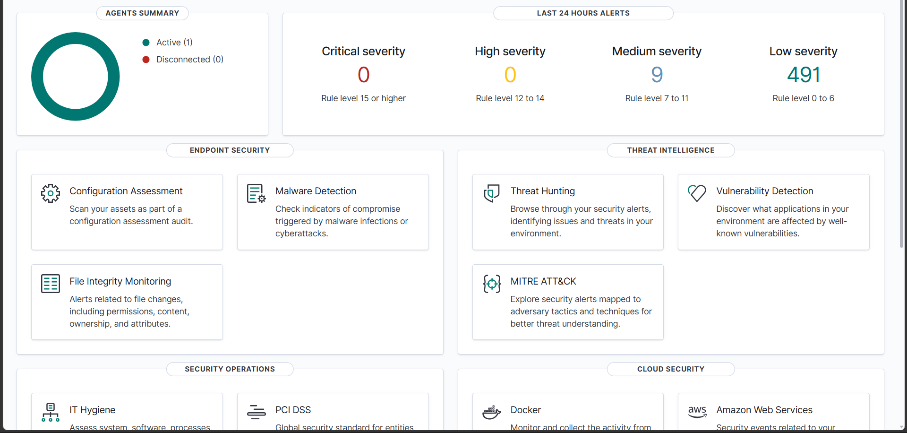
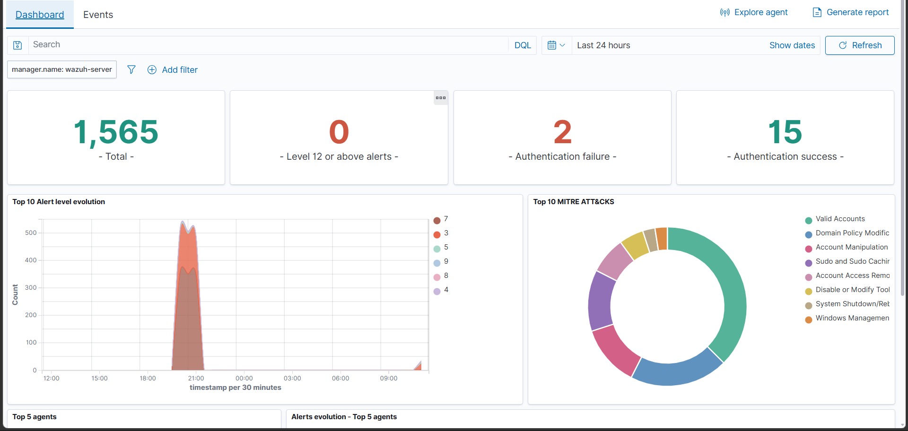
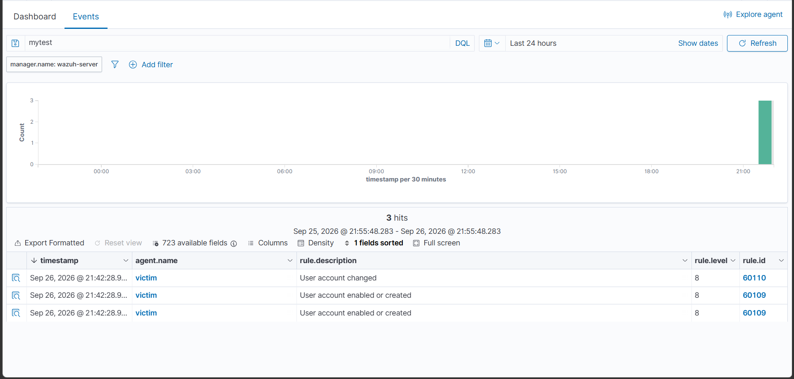
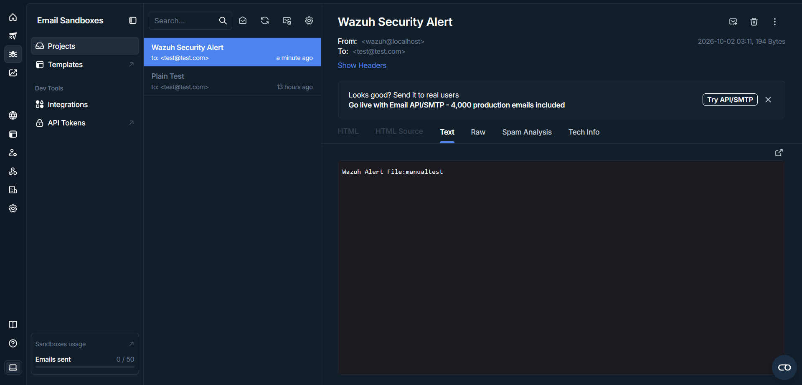

# 🛡️ Wazuh 4.14 SOC Lab — Custom Email Integration, Dual-NIC Routing & Windows Detection Use Cases

 "Objective: Simulate MITRE ATT&CK T1110 (Brute Force) & Persistence attacks on Windows endpoints to validate Wazuh detection rules and generate GRC-compliant incident reports."

A hands-on Security Operations Center (SOC) lab built on **Wazuh 4.14 OVA (Amazon Linux 2023)** with a **Windows 11 Enterprise agent**. Features a fully working alert-to-email pipeline via Mailtrap — achieved by independently root-causing four engineering failures not covered by standard documentation — plus end-to-end validated Windows detection use cases.
---

## 📌 Project Overview

The standard Wazuh email configuration **failed** in this environment for multiple technical reasons. Each failure was diagnosed and solved with custom engineering:

- ✅ Custom Python SMTP integration replacing the unstable native email module
- ✅ Dual-NIC virtual networking (isolated management + outbound internet)
- ✅ Static routing fix for asymmetric traffic across two adapters
- ✅ Manual Base64 `AUTH PLAIN` authentication to bypass OpenSSL 3 legacy-crypto restrictions
- ✅ Validated detection use cases: account manipulation, account lockout, FIM, CIS benchmarking, vulnerability detection

---

## 🏗️ Lab Architecture

| Component | Detail |
|---|---|
| **SIEM Server** | Wazuh 4.14 OVA (Amazon Linux 2023) on VirtualBox |
| **Endpoint** | Windows 11 Enterprise VM ("victim") with Wazuh agent |
| **Adapter 1** | Host-only — `192.168.75.0/24` (management + agent traffic) |
| **Adapter 2** | NAT — outbound internet for SMTP delivery |
| **Alert Delivery** | Mailtrap sandbox inbox via custom integration |

---

## 🛠️ Engineering Challenges Solved

### Bug 1 — Native `<smtp_username>` tags crash the manager
**Problem:** On this OVA build, Wazuh's native SMTP tags crash the email module.
**Solution:** Bypassed native email entirely. Wrote a custom Python integration script, triggered from `ossec.conf` via an `<integration>` block.

### Bug 2 — VM had no internet connectivity
**Problem:** The host-only adapter isolated the server, so it could not reach external SMTP relays.
**Solution:** Added a second VirtualBox adapter in **NAT** mode — outbound internet without exposing the management network.

### Bug 3 — Dual-NIC broke SSH / Dashboard routing
**Problem:** With NAT active, Linux sent return traffic for `192.168.75.0/24` out of the wrong interface, breaking SSH and dashboard access.
**Solution:** Pinned the lab subnet to the host-only interface with a static route:

```bash
sudo ip route add 192.168.75.0/24 dev eth1 src 192.168.75.5 metric 100
```

### Bug 4 — OpenSSL 3 silently kills `smtplib.login()`
**Problem:** Mailtrap offered **CRAM-MD5** auth, but OpenSSL 3 (Amazon Linux 2023) disables MD5 — so Python's `smtplib.login()` failed silently.
**Solution:** Skipped the high-level login wrapper and injected a manual Base64 **AUTH PLAIN** command directly into the SMTP session:

```python
c = base64.b64encode(("\x00" + USER + "\x00" + PASS).encode()).decode()
s.docmd("AUTH", "PLAIN " + c)
```

---

## 🔍 Detection Use Cases Validated

| Use case | Trigger on victim | Wazuh rule(s) | Result |
|---|---|---|---|
| Account creation / enable | Created & enabled local user `mytest` | 60109 / 60110 (level 8) | Alerts indexed and searchable |
| Account lockout | Repeated login errors → Event 4740 | 60115 (level 9) | Lockout alert raised |
| File Integrity Monitoring | Added/modified/deleted `c:\users\public\fimtest` | syscheck | added / modified / deleted events logged |
| CIS benchmark (SCA) | CIS Windows 11 Enterprise Benchmark v3.0.0 | SCA policy | 482 checks: 123 passed / 350 failed (26%) |
| Vulnerability detection | Package scan on Windows 11 | CVE-2026-45585 (Medium) | Flagged in Vulnerability Detection |
| Service startup change | Changed service start type | 61104 (level 3) | Persistence-style change logged |

---

## 💻 Custom Integration Script

📁 Uploaded in this repo as `custom-email.py` (server path: `/var/ossec/integrations/`)

Key techniques:
- `smtplib` + `STARTTLS` on port 587
- Manual Base64 `AUTH PLAIN` (OpenSSL 3 compatible)
- Credentials **redacted** for public release

---

## ⚙️ Wazuh Configuration (`ossec.conf`)

```xml
<integration>
    <name>custom-email</name>
    <level>7</level>
    <alert_format>json</alert_format>
</integration>
```

---

## 📸 Lab Evidence

| Wazuh Overview — agent active, severity counts | Threat Hunting — alerts + MITRE mapping |
|---|---|
|  |  |

| Events table — account creation detected | Mailtrap — alert email delivered |
|---|---|
|  |  |

---

## 🎯 Skills Demonstrated

SIEM deployment • Linux troubleshooting • Network routing • Python scripting • SMTP/TLS authentication • OpenSSL security policy • Windows event detection • MITRE ATT&CK mapping • Technical documentation

---

## 📑 GRC & Compliance Evidence

- [Incident_Report_GRC.pdf](Incident_Report_GRC.pdf) — GRC-formatted incident report for the simulated brute-force attack: ISO/IEC 27001 A.12.4, EU NIS2 Art. 21 & 23, NIST CSF 2.0, MITRE ATT&CK T1110. Cybersecurity as business protection and legal compliance — not just hacker-catching.

*Every failure documented. Every fix explained.*
